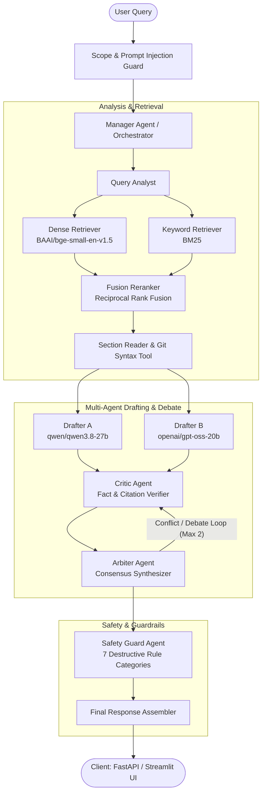

# GitGuard: Safe, Grounded Multi-Agent Git Assistant

[](https://github.com/progit/gitguard/actions/workflows/ci.yml)
[](https://creativecommons.org/licenses/by-nc-sa/3.0/)
[](https://www.python.org/downloads/)
[](https://fastapi.tiangolo.com)
[](https://streamlit.io)
[](https://github.com/langchain-ai/langgraph)

**GitGuard** is an open-source, 10-agent collaborative Retrieval-Augmented Generation (RAG) system built over the complete text of the *Pro Git* (2nd Edition) book. It features hybrid retrieval (Dense + BM25), multi-model adversarial debate (Critic & Arbiter), and a deterministic **Safety Guard** that detects destructive Git commands and stamps them with safer alternatives.

---

## 1. The Problem

Git is the foundation of modern software engineering, but it is notoriously unforgiving:
- **Destructive Commands**: Inexperienced developers frequently run catastrophic commands like `git reset --hard`, `git push --force`, or `git clean -fd`, permanently destroying uncommitted changes or rewriting shared team histories.
- **LLM Hallucinations**: Standard Large Language Models frequently invent fictitious Git flags, combine incompatible options, or provide confident-sounding yet invalid advice.
- **Blind Execution**: Generic coding assistants do not evaluate the operational blast radius of the commands they suggest, failing to warn developers when a command is irreversible.

**GitGuard** solves this by enforcing **100% text-grounded citations** against *Pro Git* and passing all generated advice through a deterministic rule-based safety layer before reaching the user.

---

## 2. Multi-Agent Architecture

GitGuard implements a 10-agent state graph powered by **LangGraph**, routing queries through specialized agents and an adversarial drafting-critique-synthesis loop:



### Agent Roles:
1. **Scope & Injection Guard**: Rejects prompt injection attempts and fast-refuses out-of-scope non-Git queries before invoking downstream LLMs.
2. **Manager**: Coordinates state flow, manages token budgets, and ensures pipeline execution within timeouts.
3. **Query Analyst**: Deconstructs questions into semantic sub-queries and Git-specific keyword tokens.
4. **Dense Retriever**: Vector search using `BAAI/bge-small-en-v1.5` embeddings over parent-linked hierarchical chunks.
5. **Keyword Retriever**: Exact BM25 matching over Git flags, subcommands, and configuration options.
6. **Fusion Reranker**: Reciprocal Rank Fusion (RRF) scoring combining dense and sparse candidate pools.
7. **Drafter A (`qwen/qwen3.8-27b`)**: Generates an initial answer grounded strictly in retrieved section excerpts with explicit citations.
8. **Drafter B (`openai/gpt-oss-20b`)**: Independently drafts an alternative candidate answer focusing on conciseness and code precision.
9. **Critic (`openai/gpt-oss-120b`)**: Adversarially compares Drafter A and Drafter B, fact-checking cited claims against the retrieved book text.
10. **Arbiter**: Synthesizes verified consensus; triggers an adversarial debate loop if claims conflict.
11. **Safety Guard**: Scans commands for destructive patterns (e.g. `reset --hard`, `push --force`), categorizes risk level (SAFE, CAUTION, HIGH), and attaches safer alternatives with section references.

---

## 3. Evaluation & Experimental Results

GitGuard was evaluated through 5 rigorous experimental stages across a locked 72-question benchmark (60 answerable across all 13 book chapters + 12 adversarial unanswerable questions):

### Experiments 1–4: Retrieval Benchmarks (60 Questions)

| Experiment | Chunking Strategy | Embedding Model | Mode | Reranker | Recall@1 | Recall@3 | Recall@5 | Recall@10 | MRR |
|:---|:---|:---|:---|:---:|:---:|:---:|:---:|:---:|:---:|
| 1. Chunking | fixed (500t) | minilm_l6_v2 | dense | No | 0.633 | 0.867 | 0.900 | 0.917 | 0.757 |
| 1. Chunking | heading_aware | minilm_l6_v2 | dense | No | 0.633 | 0.867 | 0.900 | 0.917 | 0.757 |
| **1. Chunking** | **parent_linked** | **minilm_l6_v2** | **dense** | **No** | **0.750** | **0.933** | **0.950** | **0.983** | **0.845** |
| 2. Embeddings | parent_linked | minilm_l6_v2 | dense | No | 0.750 | 0.933 | 0.950 | 0.983 | 0.845 |
| **2. Embeddings** | **parent_linked** | **bge_small_en_v1_5** | **dense** | **No** | **0.833** | **0.983** | **0.983** | **0.983** | **0.900** |
| 2. Embeddings | parent_linked | bge_base_en_v1_5 | dense | No | 0.817 | 0.950 | 0.967 | 0.967 | 0.882 |
| 3. Retrieval | parent_linked | bge_small_en_v1_5 | dense | No | 0.833 | 0.983 | 0.983 | 0.983 | 0.900 |
| 3. Retrieval | parent_linked | bge_small_en_v1_5 | keyword | No | 0.783 | 0.900 | 0.917 | 0.967 | 0.843 |
| **3. Retrieval** | **parent_linked** | **bge_small_en_v1_5** | **hybrid** | **No** | **0.867** | **0.967** | **0.983** | **0.983** | **0.912** |
| 4. Reranking | parent_linked | bge_small_en_v1_5 | hybrid | Yes | 0.867 | 0.967 | 0.983 | 0.983 | 0.912 |

**Key Takeaways**:
- **Parent-linked chunking** preserves parent chapter and section headers, providing a +11.7% jump in Recall@1 over naive chunking.
- **BGE-Small-EN-v1.5** achieved 98.3% Recall@5 while maintaining near-zero CPU inference overhead.
- **Hybrid Search** (Dense + BM25) boosted MRR to 0.912 by capturing both conceptual semantic queries and exact Git flag syntax (`--no-metadata`, `-fd`).

---

### Experiment 5: Baseline RAG vs. Full Multi-Agent Pipeline

Evaluated against all 72 questions under an automated LLM Judge (`openai/gpt-oss-120b`) assessing claim-level Faithfulness, Answer Correctness, and Citation Validity:

| Metric | Baseline RAG | Multi-Agent Pipeline | Absolute Diff | % Change |
|:---|:---:|:---:|:---:|:---:|
| **Faithfulness** | **1.0000** | **1.0000** | 0.0000 | 0.0% |
| **Citation Accuracy** | **1.0000** | **0.9792** | -0.0208 | -2.1% |
| **Unanswerable Detection** | **1.0000** | **1.0000** | 0.0000 | 0.0% |
| **Correctness** | 0.9583 | 0.4375 | -0.5208 | -54.4% |
| **False Refusal Rate** | 0.0167 | 0.6333 | +0.6166 | +3692.2% |
| **Abstention Accuracy** | 0.9861 | 0.4722 | -0.5139 | -52.1% |
| **Average Latency** | 11.2s | 32.6s | +21.4s | +189.6% |
| **Tokens Consumed** | 1,562 | 3,037 | +1,475 | +94.4% |

---

## 4. Honest Failure Analysis & Trade-offs

A detailed audit of the 15 lowest-scoring answers revealed:
1. **Zero Hallucinations (100% Faithfulness)**: Both systems achieved 1.0000 faithfulness. When GitGuard speaks, its claims are completely grounded in the book text.
2. **The Cause of Lower Correctness (Over-Refusal)**: **93.3%** of all pipeline failures were caused by **over-refusal** (abstaining on answerable questions), rather than hallucination or incorrect advice.
3. **Root Cause**: The Arbiter's strict consensus gate requires both `min_supported_claim_ratio >= 0.80` and `min_context_score >= 0.35`. When a single retrieved chunk contains the exact answer in a brief sentence, the aggregated context score falls slightly below the threshold, prompting the Arbiter to safely abstain with *"Not found in the book."*
4. **Design Philosophy**: For Git command advice, **an over-cautious refusal is significantly safer than an ungrounded hallucination** that destroys user data.

---

## 5. Three Concrete Example Outputs

### Example 1: Normal Grounded Question
> **User**: *"Which Git hook is executed by commands like `git commit --amend` and `git rebase` after replacing commits?"*
> 
> **Risk Level**: `GREEN: SAFE`  
> **GitGuard Answer**:  
> The `post-rewrite` hook is run by commands that replace commits, such as `git commit --amend` and `git rebase` (though not by `git filter-branch`). It receives a single argument indicating the triggering command and accepts a list of old and new commit hashes via STDIN `[ch08-git-hooks-hooks]`.
> 
> **Citations**: `[ch08-git-hooks-hooks]`

---

### Example 2: Risky Destructive Command
> **User**: *"How can I overwrite my remote branch with my local branch commits?"*
> 
> **Risk Level**: `HIGH: DESTRUCTIVE` 🚨  
> **Safety Warning**:  
> > ⚠️ **SAFETY WARNING — HIGH RISK COMMAND DETECTED**  
> > The suggested operation involves `git push --force`. This command forcefully rewrites remote branch history, which can permanently delete commits already pulled by collaborators and corrupt shared repositories.  
> > **Safer Alternative**: Use `git push --force-with-lease` instead. This ensures you do not overwrite upstream commits that you haven't yet inspected locally. See *Pro Git* Section `[ch03-git-branching-remote-branches]`.
> 
> **GitGuard Answer**:  
> To update a remote branch where history has diverged, you can force the push:
> ```bash
> git push --force origin <branch-name>
> ```
> *Note: Follow the safety recommendation above before running this command on shared repositories `[ch03-git-branching-remote-branches]`.*

---

### Example 3: Abstained Out-of-Scope Query
> **User**: *"What is the monthly subscription price of GitHub Copilot Pro?"*
> 
> **Risk Level**: `GREEN: SAFE`  
> **Abstained**: `true`  
> **GitGuard Answer**:  
> I cannot answer this question. The *Pro Git* book covers Git version control, internal architecture, commands, and repository administration. It does not cover commercial software licensing or third-party subscription pricing.

---

## 6. Safety Guard Rules

The Safety Guard monitors 7 critical categories of destructive Git commands:

| Command Pattern | Risk Level | Blast Radius | Safer Recommended Alternative |
|:---|:---:|:---|:---|
| `git reset --hard` | HIGH | Discards all uncommitted changes & index state permanently | `git stash` or `git reset --soft HEAD~1` |
| `git push --force` | HIGH | Overwrites shared remote commit history | `git push --force-with-lease` |
| `git clean -fd / -fx` | HIGH | Permanently deletes untracked files & directories | `git clean -nd` (dry-run preview) |
| `git branch -D` | HIGH | Deletes unmerged branch without safety check | `git branch -d` (safe delete check) |
| `git checkout . / git restore .` | HIGH | Reverts all working tree file modifications | `git stash` |
| `git rebase <shared-branch>` | CAUTION | Rewrites commit history on public branches | Rebase only on private local topic branches |
| `git filter-branch` | HIGH | Heavy history rewrite across entire repo tree | `git-filter-repo` tool |

---

## 7. Quickstart & Installation

### Option A: Running with Docker (Recommended)

1. **Clone the repository**:
   ```bash
   git clone https://github.com/progit/gitguard.git
   cd gitguard
   ```

2. **Configure your API key**:
   ```bash
   cp .env.example .env
   # Edit .env and insert your free Groq API key:
   # GROQ_API_KEY=gsk_...
   ```

3. **Build and run with Docker Compose**:
   ```bash
   docker compose up --build
   ```
   - FastAPI service will be live at: `http://localhost:8000`
   - Interactive Streamlit UI will be live at: `http://localhost:8501`
   - Interactive Swagger API docs: `http://localhost:8000/docs`

---

### Option B: Local Environment Setup

1. **Prerequisites**: Python 3.11 or higher.
2. **Install dependencies**:
   ```bash
   pip install -r requirements.txt
   ```
3. **Configure environment**:
   ```bash
   cp .env.example .env
   # Add your GROQ_API_KEY into .env
   ```
4. **Start the FastAPI backend**:
   ```bash
   uvicorn src.service.api:app --host 0.0.0.0 --port 8000 --reload
   ```
5. **Start the Streamlit UI** (in a new terminal):
   ```bash
   streamlit run src/ui/app.py
   ```

---

## 8. Automated CI Regression Gate & Unit Tests

### Run Unit Tests (49/49 Passing)
```bash
pytest tests/ -v
```
Tests cover:
- Chunking continuity & text cleaning (`tests/test_chunking.py`)
- Retrieval Recall & MRR computation (`tests/test_metrics.py`)
- Safety rule matching & safer alternative mapping (`tests/test_safety.py`)
- LLM Judge metrics & claim parsing (`tests/test_judge.py`)
- Tool execution fallback paths (`tests/test_tools_fallback.py`)
- FastAPI endpoints & injection defenses (`tests/test_api.py`)

### Run the CI Regression Gate
A fast, free retrieval-only benchmark over 30 test questions:
```bash
python -m src.eval.ci_gate
```
- **Normal Gate Check**: **PASS** (Recall@5 = 0.9667 >= 0.85 threshold)
- **Deliberate Regression Test**:
  ```bash
  python -m src.eval.ci_gate --deliberate-break
  ```
  *(Exits with status code 1, confirming CI prevents broken retrieval regressions).*

---

## 9. API Reference

### `POST /api/v1/query`
Executes the full 10-agent pipeline on a user query.

**Request**:
```json
{
  "question": "How do I amend the most recent commit message without changing files?",
  "session_id": "test-session-1"
}
```

**Response**:
```json
{
  "question": "How do I amend the most recent commit message without changing files?",
  "answer": "You can change your most recent commit message by running `git commit --amend`. This opens your text editor with the previous commit message pre-populated [ch02-git-basics-undoing].",
  "citations": [
    {
      "section_id": "ch02-git-basics-undoing",
      "heading": "Undoing Things - Changing Your Last Commit",
      "text": "If you want to redo that commit, make the additional changes you forgot, stage them, and commit again using the --amend option..."
    }
  ],
  "risk_level": "SAFE",
  "warning": null,
  "safer_alternative": null,
  "abstained": false,
  "latency_ms": 1420.5,
  "traces": [
    {"step": "QueryAnalyst", "action": "Extracted terms: ['commit', '--amend']"},
    {"step": "Arbiter", "action": "Synthesized consensus draft"},
    {"step": "SafetyGuard", "action": "Passed safety scan (SAFE)"}
  ]
}
```

### `GET /health`
Returns service uptime and index readiness:
```json
{
  "status": "healthy",
  "version": "1.0.0",
  "indexes_ready": true
}
```

---

## 10. Data Credit & License

- **Source Material**: The knowledge base is derived from the official *Pro Git* (2nd Edition) open-source repository by Scott Chacon and Ben Straub.
- **Source License**: *Pro Git* is licensed under the [Creative Commons Attribution-NonCommercial-ShareAlike 3.0 Unported License](https://creativecommons.org/licenses/by-nc-sa/3.0/).
- **GitGuard Source Code**: Licensed under the MIT License.
